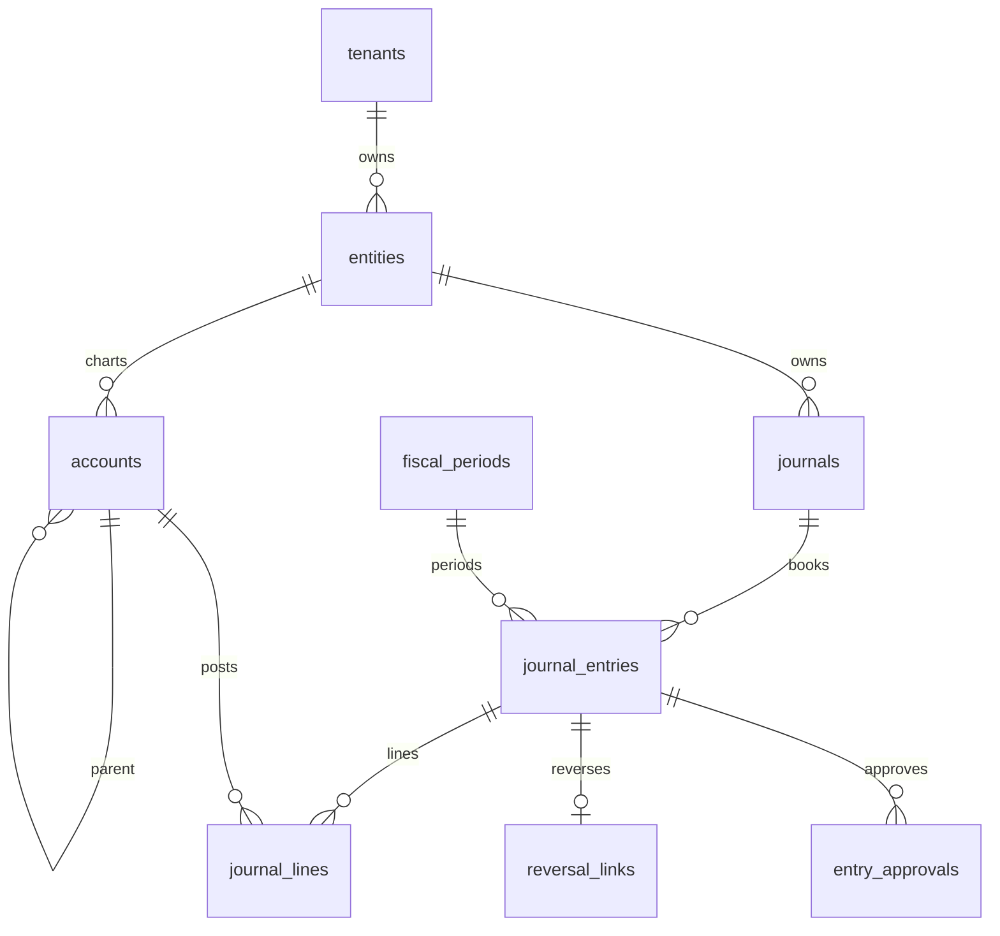

# المخرج 2: مخطط قاعدة البيانات الكامل
> الحالة: `منفذ` = مطبق في قاعدة التطوير ومُختبر. `مصمم` = مواصفة معتمدة للمرحلة الثانية.
> القواعد العامة: PK من `UUID DEFAULT gen_random_uuid()`، `tenant_id` في كل جدول،
> أعمدة تدقيق (`created_at/updated_at/created_by/updated_by/version/deleted_at/is_deleted`)،
> RLS + FORCE + سياسات `tenant_iso_*`، فهارس `(tenant, entity, date/status)`،
> `NUMERIC(18,3)` للمبالغ و`(18,10)` للصرف و`(7,4)` للنسب، و`TIMESTAMPTZ` للزمن.

## المجموعة 1: المؤسسات والعزل (منفذ)

| الجدول | الوصف | PK | أعمدة مفتاحية | FKs | فهارس/قيود |
|---|---|---|---|---|---|
| tenants | المستأجر (جذر العزل، بلا tenant_id) | id | code UQ, name_ar/en, status, timezone=Asia/Amman, default_currency=JOD | — | uq(code), ck(status) |
| plans | الباقات العمومية | id | code UQ, price(18,3), max_entities/users | — | uq(code) |
| plan_features | ميزات كل باقة | id | plan_id, feature_code, is_enabled, limit | plans, tenants | uq(plan,feature) |
| subscriptions | اشتراك المستأجر | id | plan_id, starts_on/ends_on DATE | plans, tenants | ck(end>start) |
| tenant_settings | إعدادات key/value | id | setting_key, setting_value JSONB | tenants CASCADE | uq(tenant,key) |
| tenant_domains | نطاقات مخصصة | id | domain CITEXT UQ, is_primary/verified | tenants CASCADE | uq(domain) |
| tenant_features | رايات الميزات | id | feature_code, is_enabled, limit | tenants CASCADE | uq(tenant,code) |

## المجموعة 2: الكيانات والفروع (منفذ)

| الجدول | الوصف | PK | أعمدة مفتاحية | FKs |
|---|---|---|---|---|
| entities | الكيان القانوني | id | tenant, code UQ(tenant), name_ar/en, functional_currency CHAR(3) | tenants RESTRICT |
| entity_settings | إعدادات الكيان | id | entity_id, key, value JSONB | entities CASCADE |
| entity_legal_info | بيانات قانونية 1:1 | entity_id | commercial_reg, tax_id(≥5), national_id | entities CASCADE |
| branches | الفروع | id | entity_id, code UQ(entity), name_ar, address JSONB | entities RESTRICT |
| branch_settings | إعدادات الفرع | id | branch_id, key, value | branches CASCADE |
| groups | مجموعات التجميع (هرمية) | id | code UQ(tenant), parent_id self | groups self |
| group_entities | عضوية N:M | (group,entity) | — | groups/entities CASCADE |
| group_ownership | نسب الملكية 0-100 | id | group_id, entity_id, ownership_pct(7,4), acquired_on | groups/entities |
| departments | الأقسام (هرمية) | id | entity_id, code UQ(entity), parent_id self | entities |
| positions | المناصب | id | department_id, code, title_ar | departments |

## المجموعة 3: السياسات والفترات (منفذ)

| الجدول | الوصف | PK | أعمدة مفتاحية | ملاحظات |
|---|---|---|---|---|
| accounting_policies | سياسة الكيان (IFRS/SME/نقدي) | id | entity, code, framework, inventory_method, rounding, doc_numbering JSONB, effective_from/to, status draft/approved/retired | تجميد المعتمدة (Trigger) |
| policy_versions | إصدارات مؤرخة | id | policy_id, version_no UQ, effective_from/to, changes | لا إعادة كتابة التاريخ |
| fiscal_years | سنة مالية YYYY | id | entity, code UQ(entity) CHECK YYYY, starts/ends_on, start_month 1-12, status | ck(end>start) |
| fiscal_periods | فترة YYYY-MM (1-13) | id | year_id, code UQ, period_number UQ(year), starts/ends_on, type regular/adjusting/closing, status future/open/soft/hard_closed | منع التداخل (Trigger) |
| period_locks | أقفال soft/hard | id | period_id, lock_type, reason, locked_by | — |
| closing_tasks/items/assignments | قائمة الإقفال | id | period_id, name, mandatory, seq, assignee, status | — |
| closing_snapshots | لقطة متوازنة 1:1 | id | period_id UQ, trial_balance JSONB, hash | مصدر التقارير الرسمية |

## المجموعة 4: دليل الحسابات (منفذ)

| الجدول | الوصف | PK | أعمدة مفتاحية | ملاحظات |
|---|---|---|---|---|
| accounts | الدليل (رمز نصي يحفظ الأصفار) | id | entity, code UQ(entity), name_ar(500), parent self, path/level/is_leaf آلية, type(10), control(15), normal debit/credit, postable/manual/reconcilable/partner, currency_restriction, status | منع الدوائر + أب من نفس الكيان (Trigger) |
| account_versions | إصدارات الحساب | id | account_id, version_no UQ, changes JSONB | — |
| account_hierarchy | إغلاق الهرمية | (ancestor,descendant) | depth, sort, is_leaf | استعلامات سريعة |
| account_report_mappings | ربط BS/PL/CF | (account,report) | report_code, line_code, sign plus/minus, ratio | أساس القوائم |
| account_currencies | عملات الحساب | id | account_id, currency CHAR(3), is_default | UQ(account,currency) |
| account_restrictions | قيود (يدوي/آلي) | id | account_id, type manual/auto, allowed, reason | — |
| account_balances_cache | كاش فقط (يُعاد بناؤه) | (account,period) | opening/period/closing debit/credit | ليس مصدرًا رسميًا |
| dimensions | الأبعاد (فرع/قسم/مشروع/تكلفة/ربح) | id | entity, code UQ(entity), dim_type, mandatory | — |
| dimension_values | قيم هرمية | id | dimension_id, code UQ(dim), parent, path/level | — |
| dimension_hierarchies | إغلاق القيم | (ancestor,descendant) | depth | — |
| analytic_distributions | توزيع افتراضي | id | account, dimension, value, pct | — |
| distribution_models/lines | نماذج آلية بالأولوية | id | code UQ, conditions JSONB, lines(pct مجموعها 100) | — |

## المجموعة 5: المحرك المحاسبي (منفذ — قلب النظام)

| الجدول | الوصف | PK | أعمدة مفتاحية | ضمانات |
|---|---|---|---|---|
| journals | الدفاتر | id | entity, code UQ(entity), journal_type(13), default_currency, prefix/length, require_approval | — |
| journal_sequences | تسلسل كل دفتر/سنة | (journal,year) | last_number (ذري FOR UPDATE) | رقم رسمي فريد |
| journal_entries | رأس القيد | id | entity, journal, period→fiscal_period_id, type(13), document/posting DATE, source_module/document/event_key UQ(tenant,entity), currency+rate, totals, status(7), official_number UQ, approved/posted/reversed_by+at, reversal_of, is_reversed | خالد بعد الترحيل (Trigger يسمح posted→reversed فقط) + توازن إجباري عند الترحيل |
| journal_lines | سطر بجهة واحدة XOR | id | entry CASCADE, line_number UQ(entry), account RESTRICT, debit/credit(18,3), currency, partner, due_on→due_on, branch, dims→dims JSONB, recon→recon_id | فحص فترة/حركية/كيان (Trigger) |
| event_keys | منع الازدواج | id | entity, module, document, type, version, event_key UQ(tenant,entity), process_status, resulting_entry, attempts, metadata{hash} | — |
| reversal_links | العكس الكامل مرة واحدة | id | original UQ, reversal UQ, reversed_at, reason>5, type full/partial, amount, period NOT NULL | تاريخ العكس ≥ الأصل |
| entry_approvals | الاعتمادات | id | entry, approver, type interim/final, status, seq, decided_at, expires_at | صانع≠معتمد |
| entry_attachments/comments | مرفقات/تعليقات | id | entry CASCADE, hash/path, type/internal | لا تغير القيد |

## المجموعة 6: الأطراف (منفذ — طرف موحد متعدد الأنواع)

| الجدول | الوصف | PK | أعمدة مفتاحية | ضمانات |
|---|---|---|---|---|
| parties | سجل واحد (عميل+مورد معًا) | id | entity, code UQ(entity), name_ar(500), legal_type, status(6), credit_limit, metadata | الذمم تُفصل نوعًا لا سجلًا |
| party_types + assignments | الأنواع N:M (16 نوعًا) | id | party_id, type_id, primary, validity | UQ(party,type) |
| party_categories/tags + assignments | فئات/وسوم | id | — | — |
| party_addresses | عناوين بسريان | id | party, type(7), address1, city, country CHAR(2), primary, valid_from/to | رئيسي واحد (فهرس جزئي UQ) |
| party_contacts + verifications | اتصالات + توثيق OTP | id | party, type(9), value, primary/verified | رئيسية واحدة |
| party_relationships | علاقات موجهة | id | from≠to CK, type(11), ownership_pct, guarantee | منع الذاتية + UQ |
| party_bank_accounts + approvals | حسابات باعتماد | id | party, bank, IBAN CHECK, primary, approved | تعديل IBAN يعيد الاعتماد |
| party_tax_profiles/registrations | ملفات ضريبية لكل دولة | id | party, country, tax_id(≥5) UQ(party,tax,country), إعفاءات مؤرخة | — |
| party_credit_limits/history | حدود + سجل تلقائي | id | party, limit≥0, currency | Trigger يكتب السجل |

## المجموعة 7: الأصناف (منفذ)

products (code UQ, type 7, category, base/purchase/sale UoM, cost_method, standard/avg_cost, reorder, track serial/lot/expiry) + product_categories (هرمية) + product_types + attributes/values + variants + barcodes UQ + uoms/uom_categories/conversions + product_uoms + price_lists/items + product_prices + product_taxes (tax_id يُشدّد مرحلة الضرائب) + product_accounts (revenue/expense/stock/cogs) + product_suppliers.

## المجموعة 8: المخزون (منفذ)

warehouses (+zones) + locations (هرمية بأنواع 8) + stock_moves (10 أنواع، 6 حالات، المنتهية خالدة) + move_lines + stock_quants (كاش PK مركب، متاح=كمية−محجوز) + reservations + valuation_layers (FIFO/متوسط) + valuation_entries + adjustments(+lines بفروق محسوبة) + counts(+lines) + lots UQ + serials UQ + packages + transfers(+lines) + scrap(+lines) + landed_costs(+lines+allocations). منع السالب افتراضيًا.

## المجموعة 9: المبيعات Quote-to-Cash (منفذ)

sales_teams/members/reps/targets/commissions + quotations(+lines+versions+approvals، 9 حالات) + sales_orders(+lines+versions+amendments بكميات مطلوبة/مسلمة/مفوترة، 10 حالات) + deliveries(+lines+packages+tracking) + customer_invoices(+lines+taxes+versions+einvoicing، 11 حالة، UQ(event)، قاعدة posted مجمدة مع سماح التحصيل) + customer_payments(+lines) + payment_allocations UQ(payment,invoice) (Trigger يلفّ المتبقي والحالة) + payment_terms(+lines) + customer_returns(+lines) + credit/debit_notes(+lines) + revenue_recognition_schedules/entries + deferred_revenue_balances (مشتق) + pos_sessions/orders/payments + einvoicing_queue (JoFotara: queued→accepted/rejected) + aging_snapshots(+lines).

## المجموعة 10: المشتريات Request-to-Pay (منفذ)

purchase_requests(+lines+approvals) + purchase_orders(+lines بordered/received، تأكيد) + goods_receipts(+lines → إدخال مخزني + متوسط تكلفة) + vendor_bills(+lines، ترحيل: مخزون/مصروف مدين / مورد دائن) + vendor_payments(+allocations مع لفّ المتبقي) + vendor_returns. المطابقة الثلاثية (طلب/استلام/فاتورة) إجراء تطبيقي موثق.

## المجموعة 11: الخزينة (منفذ)

currencies (5 عملات) + taxes (VAT16) + cash_boxes (رصيد=افتتاحي+مقبول−مدفوع مرحّل) + cash_transactions (in/out برقم CT متسلسل + قيد مسودة→مرحّل) + banks + bank_accounts + checks (issued/cashed/bounced) + transfers (برقم TR + قيد من حسابين صريحين). كشوف البنوك والمطابقة الآلية: مصممة للمرحلة الثانية.

## المجموعة 12: الأصول والاستحقاقات (منفذ جزئيًا)

asset_categories (عمر/طريقة) + assets (كلفة/مجمع/صافي، ثابت/متناقص) + ترحيل الإهلاك قيدًا. deferral/provision/accrual/prepayment: جداول phase12 الأصلية موجودة تصميمًا وتُبنى عند الطلب (التسويات اليدوية متاحة عبر قيود التسوية).

## المجموعة 13: التمويل (مصمم — مرحلة 2)

loans(+schedules/transactions/covenants) + leases(+liabilities/ROU/modifications) + equity/dividends/partners + grants. التصميم: كل قسط/فائدة حدث يرحّل قيدًا؛ العقود تحمل جدول استحقاق ومعدل خصم.

## المجموعة 14: العملات (منفذ أساسًا)

currencies + exchange_rates (يُضاف: أنواع الأسعار والمصادر وإعادة التقييم الدورية بقيد فروقات). القاعدة: المبلغ الوظيفي = المبلغ × السعر، والفروقات بقيد مستقل لا تعديل.

## المجموعة 15: الضرائب (منفذ أساسًا)

taxes (VAT16 + أنواع sale/purchase/withholding/exempt/zero) + ربط الأصناف والفواتير + ملخص الالتزام (محصّل مرحّل) + طابور JoFotara. الإقرارات الرسمية وشهادات الخصم: مرحلة 2 مع القوالب الحكومية.

## المجموعة 16: الرواتب (منفذ — أردني)

employees (ضمان/بنك/إجمالي محسوب) + income_tax_brackets (شرائح سنوية قابلة للضبط، إعفاء 9000) + payroll_runs (مجمعات) + payslips(+lines: استحقاق/استقطاع/كلفة صاحب عمل) + employee_loans (خصم تلقائي بحد المتبقي) + leave_requests. القيد: رواتب+ضمان صاحب عمل مدينة / صافي+ضمان+ضريبة دائنة.

## المجموعة 17: التعليم (منفذ)

students (+party) + guardians (+party، مسؤول مالي) + student_guardians + fee_contracts (صافي بعد خصم، UQ طالب/عام) + fee_installments (حالات) + fee_payments (تخصيص تلقائي + قيد قبض). الاستحقاق: ذمم/إيراد تعليمي. المنح/الاسترداد/النقل: مرحلة 2.

## المجموعة 18: المشاريع والموازنات (منفذ)

projects (موازنة/حالة) + project_costs/revenues (مرتبطة بقيود) + هامش محسوب + budgets(+versions) + budget_lines UQ(budget,account) + انحراف مخطط/فعلي (الفعلي من مرحّل سنة الموازنة). الالتزامات والمناقلات: مرحلة 2.

## المجموعة 19: التجميع (مصمم — مرحلة 2)

consolidation_runs (مجموعة/فترة) + eliminations للبيئية + تسعير بيئي + حقوق غير مسيطرين + فروق ترجمة. المبدأ: كيانات بعملات وظيفية مختلفة تُترجم ثم تُستبعد البيئية بقيد تجميع.

## المجموعة 20: التصنيع (مستبعد — خارج النطاق)

BOMs/routings/work-centers/orders/MRP: خارج نطاق v1 صراحةً (وثيقة النطاق).

## المجموعة 21: الأمان والتدقيق (منفذ)

users (+profiles/sessions+jti/MFA/password_history) + roles (13 دورًا بمصفوفة) + permissions (كتالوج) + role_permissions + user_roles (+نطاق كيان) + delegations + audit_logs (إلحاقي بلا UPDATE/DELETE) + login_attempts + api_keys. مطابقة JWT/Hader (403) + RLS + bcrypt.

## المجموعة 22: الهجرة والتقارير (منفذ أساسًا)

migration_projects/batches/records + opening_balances (قيد افتتاحي متوازن واحد لكل كيان) + report_templates + report_snapshots(hash) + schedules + KPIs + notifications(queue). التقارير الرسمية من اللقطات دائمًا.

## المجموعة 23: التكاملات (مصمم — مرحلة 2)

integrations/configs/credentials (Vault) + logs/retries + webhooks(endpoints/deliveries) + api_request_logs/rate_limits. القاعدة: كل اتصال خارجي idempotent ومسجل بطلب/استجابة.

## المجموعة 24: المرفقات (منفذ جزئيًا)

entry_attachments + party_attachments (مسار خارجي + hash + حد 50MB). التخزين الموحد S3-متوافق: مرحلة 2.

## المجموعة 25: الجداول المرجعية (منفذ)

currencies/countries/payment_methods كبيانات (5 عملات + طرق قبض/صرف/تحويل/شيك/POS).

## استراتيجيات قاعدة البيانات

- **الفهرسة:** كل FK مفهرس؛ مركبات `(tenant,entity,date/status)`؛ جزئية `WHERE is_deleted=FALSE`؛ `UQ(entity,code)` للمرجعية؛ GIN (trgm عربي + JSONB)؛ BRIN للزمنيات الكبيرة.
- **التقسيم:** شهري للقيود/السطور/الفواتير/التدقيق (4b عند 5M صف)؛ ربعي للمخزون. المفتاح ضمن PK (قيد مركب) — موثق في phase4.
- **النسخ الاحتياطي:** يومي كامل + WAL مستمر + PITR (30 يومًا) + اختبار استعادة أسبوعي + نسختان جغرافيتان + تشفير AES-256.
- **الأداء:** التقارير من اللقطات؛ الأرصدة من الكاش القابل لإعادة البناء مع مطابقة دورية؛ ترقيم 50؛ `EXPLAIN` للاستعلامات الحرجة في CI.

---

## 26. تغييرات المخطّط (2026-10-13)

يُدار المخطّط عبر ``db/sql/phase*.sql`` + ``fix_*.sql`` (لا alembic). تغييرات هذه الجلسة:

- ``customer_invoices.cogs_posted BOOLEAN NOT NULL DEFAULT FALSE`` — يمنع ازدواج تكلفة البضاعة المباعة (التسليم مقابل الفاتورة). Migration: ``db/sql/fix_invoice_cogs_flag.sql``.
- ``checks.journal_entry_id UUID REFERENCES journal_entries(id)`` — القيد الناتج عن صرف الشيك.
- ``checks.reversal_entry_id UUID REFERENCES journal_entries(id)`` — قيد عكس الشيك المرتد.
- ``transfers.journal_entry_id UUID REFERENCES journal_entries(id)`` — قيد التحويل المخزّن.
- ``stock_moves.journal_entry_id UUID REFERENCES journal_entries(id)`` — قيد COGS/التسوية.

قيد ``control_type`` يقبل فقط: ``general, customer, supplier, employee, inventory, asset, bank, cash, tax, loan, equity, receivable, payable, prepaid, accrued``.

**ملاحظة صلاحيات:** مستخدم التطبيق ``accounting`` لا يملك الجداول (المالك ``postgres``)، لذلك تُطبَّق تغييرات المخطّط يدويًا بـ ``psql`` بصلاحيات ``postgres``، لا عبر SQLAlchemy.