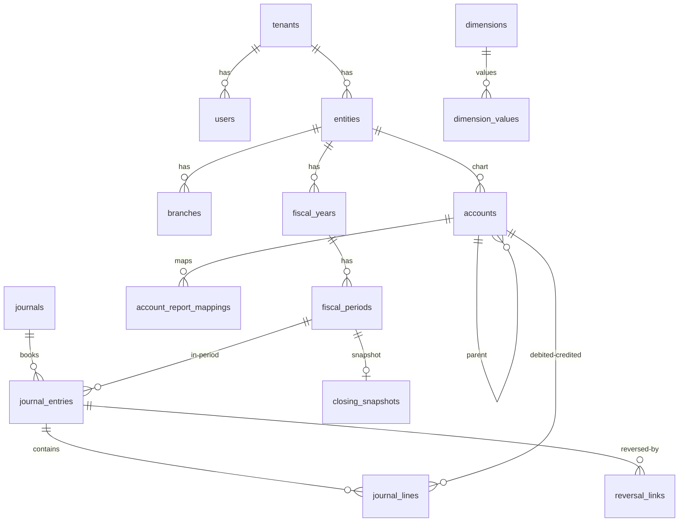

# docs/ERD.md — مخطط العلاقات (نواة v1 — تُوسّع لكل مجموعة)



**قاعدة قراءة:** كل سهم `}o--` يحمل `tenant_id` في الطرفين + FK مع `ON DELETE RESTRICT`
(عدا جداول الحركات `CASCADE` من الرأس إلى السطور فقط).
الأرصدة لا تُخزن — تُشتق عبر `fn_calculate_trial_balance` من `journal_lines↔entries WHERE status='posted'`.
```
