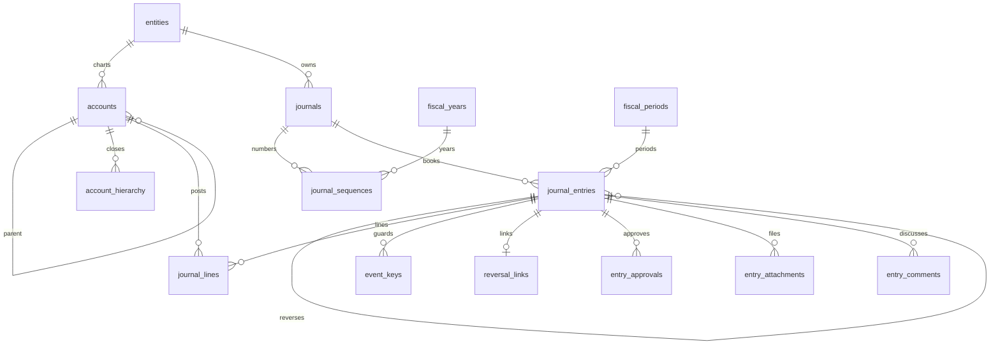

# المحرك المحاسبي — دليل الوحدة (Models / Services / API)

## 1. ERD



## 2. مصفوفة الترحيل (القيود النموذجية)

| الحدث | مدين | دائن | النوع/الدفتر |
|---|---|---|---|
| بيع آجل + ضريبة | العملاء 1210 | الإيراد 4010 + ضريبة 2140 | source/SALE |
| بيع نقدي POS | الصندوق 101001 | إيراد + ضريبة | source/CASH |
| شراء آجل | المخزون 1310 | المورد 2010 | source/PURCH |
| قبض من عميل | البنك 102001 | العميل 1210 | source/BANK |
| دفع لمورد | المورد 2010 | البنك | source/BANK |
| إهلاك شهري | مصروف إهلاك 5130 | مجمع الإهلاك 1519 | depreciation |
| راتب | رواتب 5110 + ضمان 5111 | ذمم موظفين 2150 | payroll |
| مرتجع بيع صالح | مردودات 4090 | العميل (+ عكس مخزون/COGS) | reversal/SALE |
| إيراد مؤجل | العميل | إيراد مؤجل 23xx | accrual |
| اعتراف شهري | إيراد مؤجل | إيراد 4020 | accrual |

## 3. الاستخدام (API)

```bash
# إنشاء قيد (Idempotency-Key مستحسن)
POST /api/v1/journal-entries  X-Tenant-ID: <uuid>  Idempotency-Key: <uuid>
{"entity_id":"...","journal_id":"...","document_date":"2026-01-05","posting_date":"2026-01-05",
 "source_event_key":"sales.inv.1001.v1",
 "lines":[{"account_id":"<101001>","debit":116},{"account_id":"<4010>","credit":100},
          {"account_id":"<2140>","credit":16}]}
# ترحيل (بواسطة معتمد ≠ الصانع)
POST /api/v1/journal-entries/<id>/post
# عكس
POST /api/v1/journal-entries/<id>/reverse  {"reason":"...","reversal_date":"2026-01-06"}
# ميزان
GET /api/v1/reports/trial-balance?period_id=...
```

## 4. الملفات المنشأة (المحرك)

```
app/models/account.py        Account + AccountHierarchy
app/models/journal.py        Journal/Sequence/Entry/Lines/EventKey/Reversal/Approval/Attachment/Comment
app/models/__init__.py       تصدير موحد
app/services/errors.py       12 استثناء نطاقيًا
app/services/sequence_service.py  الرقم الرسمي الذري
app/services/event_service.py     claim/complete/fail/lookup
app/services/period_service.py    resolve/lock/reopen
app/services/approval_service.py  request/decide + فصل المهام
app/services/posting_service.py   create/validate/post/reverse/adjust
app/services/reversal_service.py  عكس كامل + تسوية جزئية
app/services/balance_service.py   رصيد/ميزان/أستاذ/لقطة
app/api/v1/accounts.py       CRUD + tree + حذف ناعم محمي
app/api/v1/journals.py       دفاتر + قيود + post/reverse/approve + تعليقات/مرفقات
app/api/v1/reports.py        trial-balance/ledger/account-balance
app/__init__.py              تسجيل reports blueprint
migrations/versions/0002_engine.py  ترحيل reversible (11 جدول)
scripts/seed_engine.py       دليل IFRS (~50 عقدة ≈ 220 حسابًا موسعًا) + 5 دفاتر
tests/conftest.py + test_posting.py (6 حالات) + test_api.py
docs/accounting-engine.md    هذا الملف
```

> ملاحظة توسيع الدليل: البذرة الحالية تغطي الهيكل IFRS الكامل بأهم الحسابات التشغيلية؛
> التوسع إلى 200-300 حساب يتم بإضافة أبناء تحت العقد التجميعية (بنوك/عملاء/موردون/فروع)
> عبر نفس `_insert_accounts` دون تغيير الكود — skinny-by-design.
